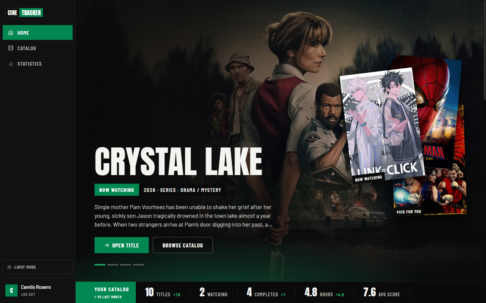
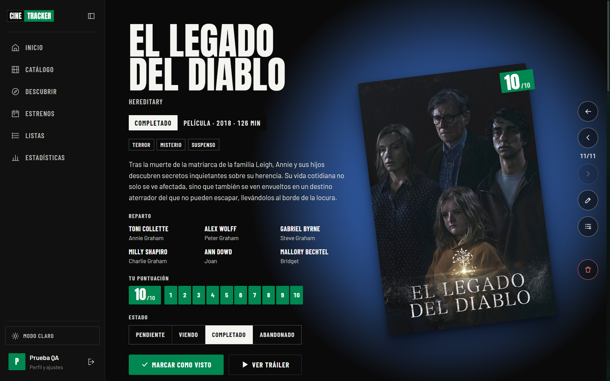
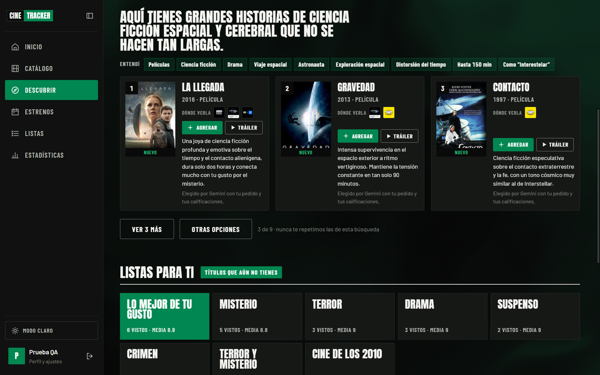
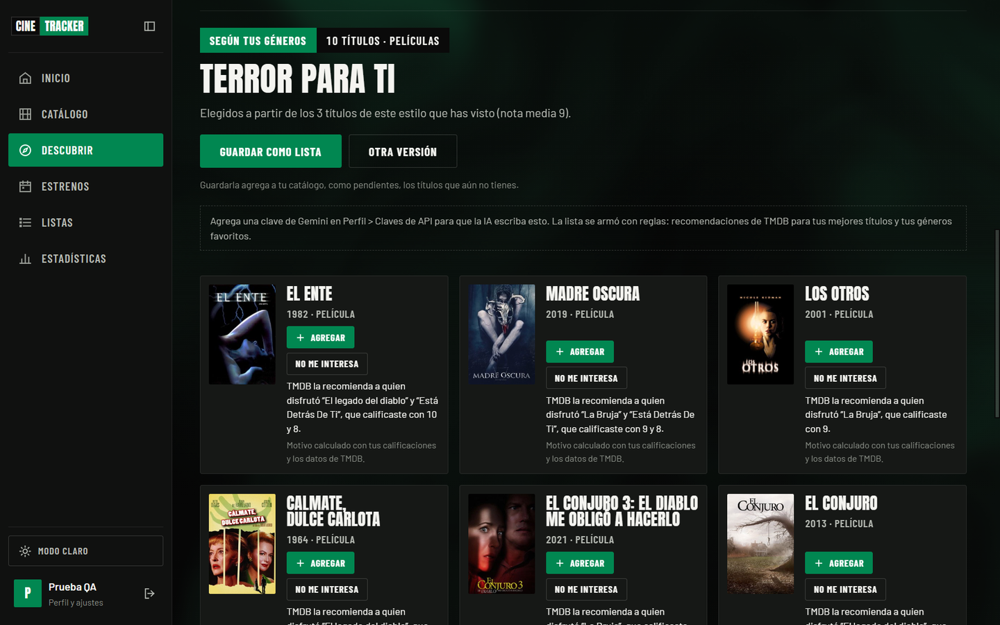
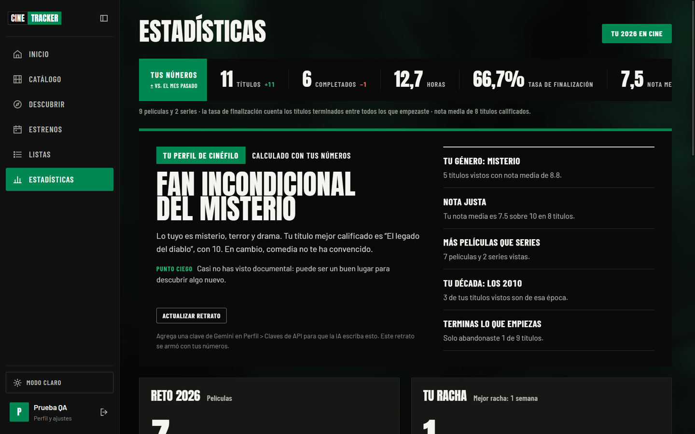
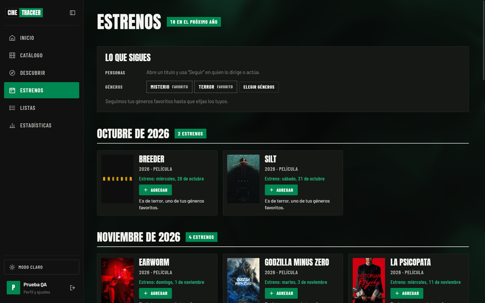
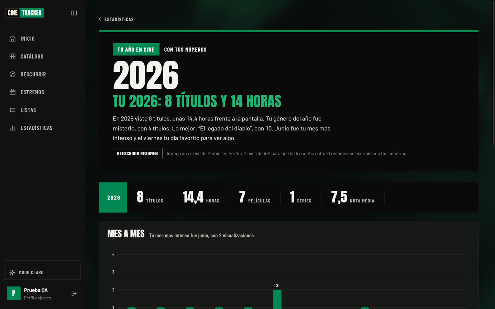
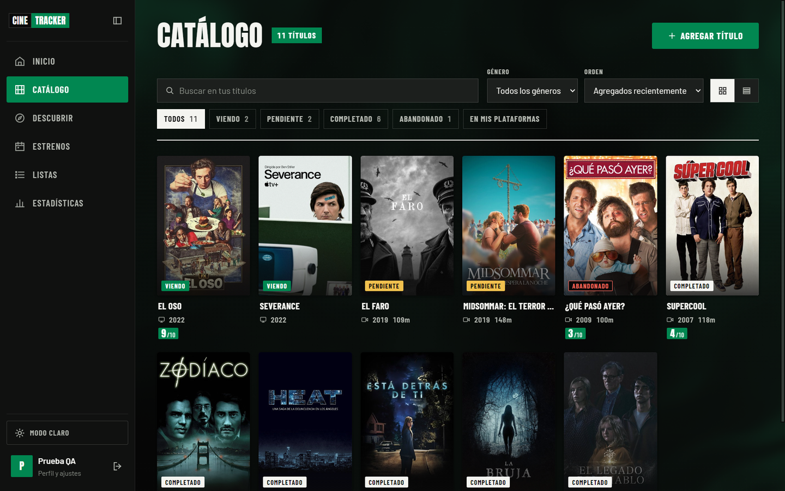

# CineTracker

Una aplicación de escritorio para realizar un seguimiento, calificar y obtener recomendaciones de las películas y series que ves.


[](https://github.com/KmiloRosero/CineTracker/actions/workflows/ci.yml) 
## What it does

- **Catálogo y páginas de títulos:** Búsqueda en TMDB, estado, calificaciones del 1 al 10, historial de visualización, notas, listas, tráilers, dónde ver en Colombia, orden de la saga y títulos similares.
- **Descubrir:** Listas generadas por IA basadas en tus gustos (por ejemplo, terror a fuego lento) con una justificación para cada elección, *¿Qué veo esta noche?* según tu estado de ánimo y el tiempo que tengas, y búsqueda de títulos a partir de descripciones vagas. Cada sugerencia es un título real de TMDB; la IA solo selecciona y explica.
- **Tus gustos en palabras:** Un perfil cinéfilo en Estadísticas, un resumen anual con premios, y *¿Te va a gustar?* con una puntuación estimada para cada título.
- **Series y estrenos:** Progreso episodio por episodio, un carrusel de nuevos episodios y próximos estrenos de las personas y géneros que sigues.
- **Hábitos y datos:** Un reto anual, rachas semanales, tus plataformas de streaming como filtro, importación desde Letterboxd e IMDb, y exportación a CSV o a Letterboxd.


| Home | Title showcase |
|---|---|
|  |  |
| **¿Qué veo esta noche?** | **Descubrir** |
|  |  |
| **Statistics** | |
|  | |
| **Estrenos** | **Tu año en cine** |
|  |  |
| **Catalog** | |
|  | |


## Scripts

Run from `frontend/`:

| Script | What it does |
|---|---|
| `npm run dev` | Vite dev server and Electron with hot reload |
| `npm test` | All tests: backend and interface (Vitest under Electron's Node) |
| `npm run test:watch` | Tests in watch mode |
| `npm run smoke` | Starts the real app with a throwaway profile and exits 0 when the database opened and the interface rendered without errors (what CI runs on each system) |
| `npm run typecheck` | TypeScript check of `src` (the `.tsx` components in `src/components/ui`) |
| `npm run build` | Production build of the interface into `frontend/dist` |
| `npm run dist:win:public` | The installer and portable `.exe` published on GitHub, with only the TMDB key so it works right after installing |
| `npm run dist:win` | The same with every key in `backend/.env` (`-con-gemini`), for your own use |
| `npm run dist:win:nokeys` | The same, without any API keys (`-sin-claves`), safe to share |
| `npm run dist:mac` / `npm run dist:linux` | macOS DMG / Linux AppImage |

Packages are written to `C:/CineTracker-release` (see `frontend/electron-builder.json`).

---


---

## Project structure

```
CineTracker/
├── backend/                     runs inside Electron's main process
│   ├── db/                      database.js, schema.sql (baseline), migrations.js
│   ├── ipc/handlers.js          IPC channels → services
│   ├── models/                  JSDoc types for Title, Record, List, User
│   ├── repositories/            SQL for titles, records, lists, users
│   ├── services/                auth, title, record, list, statistics, recommendation,
│   │                            aiRecommendation, tmdb, imageCache
│   ├── tests/                   Vitest suites
│   ├── utils/                   env, genres, session, validators
│   └── .env.example
├── frontend/
│   ├── electron/                main.js (window, security, ctimg protocol), preload.js
│   ├── src/
│   │   ├── pages/               Home, Catalog, TitleDetail, Lists, ListDetail,
│   │   │                        Statistics, Profile, Login
│   │   ├── components/          FixtureCard, ScoreBug, Ticker, Modal, AuthForm, ...
│   │   ├── context/             AuthContext
│   │   ├── hooks/               useRequireAuth, useTheme, useCountUp, ...
│   │   ├── services/tmdbApi.js  renderer wrappers for the TMDB IPC channels
│   │   ├── styles/theme.css     design tokens and all styles
│   │   └── utils/
│   ├── electron-builder.json
│   └── package.json
├── DESIGN.md                    visual system (tokens, components, rules)
└── PRODUCT.md                   product context
```

---

## License

MIT © 2026 Camilo Rosero
