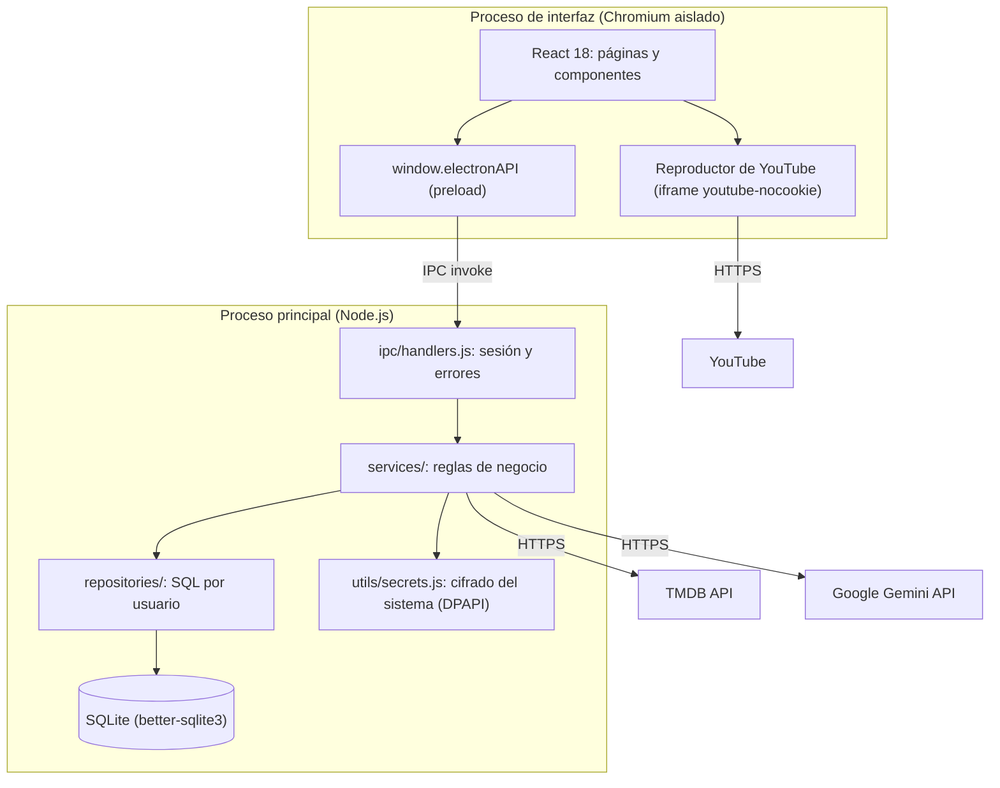
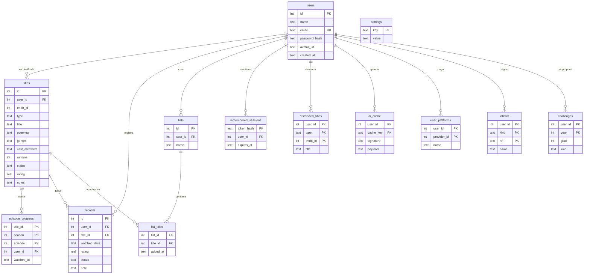

# CineTracker: informe técnico

**Proyecto final de Ingeniería de Software**
Universidad Cooperativa de Colombia (UCC), sede Pasto
Autor: Camilo Rosero
Versión de la aplicación: 1.2.0

---

## 1. Resumen

CineTracker es una aplicación de escritorio para registrar, calificar y descubrir películas y series. Funciona sin servidor propio: los datos de cada usuario se guardan en una base de datos SQLite en su computador. Se conecta a tres servicios externos:

- **TMDB:** metadatos, pósters y tendencias.
- **YouTube:** tráilers.
- **Google Gemini:** recomendaciones escritas por inteligencia artificial.

Si alguno de estos servicios falla, la aplicación sigue funcionando.

La interfaz está en español y sigue un sistema visual propio inspirado en las transmisiones deportivas: negro, verde cancha (#018751), titulares condensados, "lower-thirds" y marcadores de puntuación. Tiene tema claro y oscuro.

---

## 2. Requisitos cubiertos

| Requisito | Cómo se cumple |
|---|---|
| Uso como invitado y con cuenta | Los invitados ven tendencias y tráilers. Las acciones que modifican datos abren un inicio de sesión y, al terminar, continúan solas. |
| Varias cuentas por instalación | Cada título, registro y lista pertenece a un `user_id`; todas las consultas se filtran por usuario. |
| Catálogo con TMDB | Búsqueda con espera de 400 ms, navegación con teclado, vista previa con reparto; respaldo de entrada manual. |
| Ficha del título | Puntuación 1–10, estado, historial de visualizaciones, reparto, notas, listas, navegación entre títulos. |
| Tráilers | Selección automática del mejor tráiler de TMDB y reproducción con un componente reutilizable de YouTube. |
| Lo que sigue | La saga en orden (o las temporadas), títulos parecidos y próximos estrenos del mismo género en la ficha de cada título. |
| Dónde verla | Plataformas legales en Colombia (suscripción, gratis, alquiler, compra) con enlace a cada una. |
| Presentación | Cuatro pasos la primera vez que se abre la app, que explican para qué sirve y sus funciones; se puede saltar y volver a ver desde Perfil. |
| Recomendaciones | Gemini con salida JSON validada; motor por reglas como respaldo, siempre con el motivo de cada recomendación. |
| Descubrir con IA | Listas por estilo con títulos nuevos de TMDB explicados por la IA, "¿Qué veo esta noche?" por ánimo y tiempo, y búsqueda de un título por su descripción. |
| Perfil, año y análisis | Retrato del gusto del usuario, resumen anual con premios y "¿Te va a gustar?" en cada título. |
| Series y estrenos | Progreso por episodio, aviso de episodios nuevos y próximos estrenos de personas y géneros seguidos. |
| Datos y hábitos | Importación desde Letterboxd e IMDb, exportación a CSV y Letterboxd, plataformas del usuario, reto anual y rachas semanales. |
| Estadísticas | Totales con tendencia mensual, actividad de 12 meses, estados, géneros; cada gráfica con vista de tabla. |
| Listas, perfil y ajustes | Listas con nombre; foto y nombre; cambio de contraseña; tema; claves de API; eliminación de cuenta. |
| Sesión recordada | Opcional, 30 días, con token cifrado por el sistema operativo. |
| Accesibilidad | Etiquetas en todos los controles, foco visible, contraste AA en ambos temas, objetivos de 44 px, respeto de "reducir movimiento". |
| Entrega | Instalador NSIS en español y versión portátil para Windows; variante sin claves para compartir. |

---

## 3. Arquitectura

### 3.1 Vista general



La aplicación sigue una arquitectura por capas dentro de Electron:

- **Interfaz (renderer):**
  - Corre en Chromium con `contextIsolation`, `sandbox` y sin `nodeIntegration`.
  - No tiene acceso a Node, al disco ni a las claves de API. Todo pasa por los métodos de `frontend/electron/preload.js`.
- **Canal IPC:**
  - `backend/ipc/handlers.js` registra cada canal y resuelve el usuario de la sesión.
  - Los canales de lectura devuelven resultados vacíos a los invitados; los que modifican datos los rechazan.
  - Los errores de validación llegan al usuario con un mensaje en español. Los errores internos (SQL, programación) se registran y se muestran como un mensaje genérico.
- **Servicios:** validan la entrada y aplican las reglas de negocio (`auth`, `title`, `record`, `list`, `statistics`, `recommendation`, `aiRecommendation`, `tmdb`, `imageCache`, `apiKey`, `remember`).
- **Repositorios:** contienen solo SQL parametrizado y siempre filtran por `user_id`.
- **Base de datos:**
  - SQLite en la carpeta de datos del usuario.
  - Migraciones versionadas con `PRAGMA user_version`; cada una corre una sola vez, dentro de una transacción, después de copiar el archivo de la base de datos.

### 3.2 Estructura del código

```
backend/      db/ (esquema y migraciones) · ipc/ · repositories/ · services/ · utils/ · tests/
frontend/     electron/ (main.js, preload.js) · src/ (pages, components, context, hooks, utils, styles)
docs/         manual de usuario, informe técnico y capturas
```

### 3.3 Modelo de datos



`lists` tiene además `description` y `list_titles` tiene `note`: las listas generadas en Descubrir guardan su presentación y el motivo de cada título.

Migraciones:

| Versión | Cambio |
|---|---|
| 0 | Esquema base (`schema.sql`). |
| 1 | Propiedad por usuario de títulos, registros y listas. Los datos que existían pasan a la cuenta más antigua. |
| 2 | Reparto (`cast_members`) en los títulos. |
| 3 | Sesiones recordadas (`remembered_sessions`). |
| 4 | Listas generadas (`lists.description`, `list_titles.note`), títulos descartados (`dismissed_titles`) y caché persistente de la IA (`ai_cache`). |
| 5 | Plataformas de cada usuario (`user_platforms`). |
| 6 | Progreso por episodio (`episode_progress`). |
| 7 | Personas y géneros seguidos (`follows`). |
| 8 | Retos anuales (`challenges`). |
| 9 | Historial de sugerencias (`suggestion_log`), para no repetir. |

Los géneros se guardan con su nombre en inglés de TMDB, obtenido a partir del identificador del género. Así los datos son estables aunque los metadatos se pidan en español, y la interfaz los traduce al mostrarlos. Los géneros combinados de series (por ejemplo "Sci-Fi & Fantasy") se separan en sus equivalentes de película para que las estadísticas cuenten películas y series juntas.

---

## 4. Integraciones externas

### 4.1 TMDB

- Las llamadas salen del proceso principal, así la clave nunca llega a la interfaz.
- Los metadatos se piden en español latinoamericano (`es-MX`). Si un título no tiene sinopsis en español, se usa la de inglés.
- Los pósters y fondos se sirven por un protocolo propio, `ctimg://`, que los guarda en disco. Así el catálogo funciona sin internet después de ver cada imagen una vez.

### 4.2 Tráilers (YouTube)

- **Selección** (`tmdbService.getTrailer`): entre los videos de TMDB se descartan los que no son de YouTube y los identificadores mal formados. El resto se ordena así:
  1. Tráiler antes que avance (teaser).
  2. Español antes que inglés.
  3. Oficial antes que no oficial.
  4. Más reciente primero.

  El resultado se guarda en caché seis horas.
- **Componente reutilizable** (`YouTubePlayer.jsx`):
  - Inserta el reproductor del dominio de privacidad mejorada `youtube-nocookie.com` en un `iframe` 16:9 con `sandbox`, título accesible y estado de carga.
  - Valida que el identificador tenga el formato de YouTube antes de construir la URL.
  - `TrailerModal.jsx` lo usa desde el Inicio y desde la ficha del título.
- **Seguridad en Electron:**
  - La política de seguridad de contenido solo permite marcos de `youtube-nocookie.com`, y el proceso principal bloquea cualquier navegación de un marco hacia otro origen.
  - El único permiso concedido es la pantalla completa, y solo al reproductor.
  - Los enlaces a YouTube se abren en el navegador del sistema.
- **Error 153:** YouTube rechaza los videos insertados cuya petición no indica de dónde viene. Una aplicación empaquetada carga sus páginas desde `file://` y no envía esa cabecera. Como YouTube pide a las aplicaciones de escritorio y WebView, la petición del reproductor se identifica con la aplicación (`Referer: https://com.cinetracker.app/`).

### 4.3 Lo que sigue: saga, temporadas, parecidas y estrenos

`tmdbService.getRelated` reúne en una sola llamada IPC lo que se muestra debajo de la ficha de un título:

- **Saga:** si la película pertenece a una colección de TMDB, se piden sus partes y se ordenan por fecha de estreno (las que no tienen fecha van al final). Cada parte indica si es la actual y si todavía no se estrena.
- **Temporadas:** en las series, las temporadas en orden (sin la temporada 0 de especiales), con el próximo episodio anunciado.
- **Parecidas:** las recomendaciones de TMDB, sin repetir las partes de la saga.
- **Próximos estrenos:** búsqueda (`discover`) de títulos del mismo género con fecha de estreno futura, primero con los dos géneros principales y ampliada a uno si hay pocos resultados. Se descartan los que no tienen póster y los que no están en español o inglés ni tienen el título traducido.

Si la colección o la búsqueda de estrenos fallan, el resto se muestra igual. El resultado se guarda en caché seis horas. En la interfaz, `RelatedTitles.jsx` reutiliza las tarjetas del Inicio (`FixtureCard`) con el número de parte y una etiqueta sobre el póster (Estás aquí, Sigue, Próximamente).

### 4.4 Dónde verla (proveedores de streaming)

`tmdbService.getWatchProviders` consulta `/watch/providers` de TMDB (datos de JustWatch) y se queda con la región de Colombia, agrupando las plataformas en suscripción, gratis (con o sin anuncios), alquiler y compra. TMDB no entrega enlaces directos a cada plataforma, así que para las principales se arma la URL de su búsqueda con el título y el resto usa la página "Dónde ver" de TMDB, que enlaza a cada servicio. El proceso principal solo abre enlaces `https` de una lista de dominios permitidos (TMDB y esas plataformas). La aplicación muestra únicamente opciones legales; no enlaza a sitios de descarga o streaming no autorizados.

### 4.5 Componentes con Tailwind, TypeScript y estructura shadcn

El inicio de sesión usa un componente con fondo de humo en WebGL y una tarjeta de vidrio, escrito en TypeScript con clases de Tailwind (`src/components/ui/login-form.tsx`). Para integrarlo sin alterar el resto de la interfaz, que usa CSS propio:

- **Estructura shadcn:** `components.json` define los alias (`@/components/ui`, `@/lib/utils`). `src/lib/utils.ts` exporta `cn` (clsx + tailwind-merge). Los componentes reutilizables de este tipo van en `src/components/ui`, donde los busca la CLI de shadcn al agregar otros.
- **Tailwind:** solo genera clases para `src/components/ui`, y su "reset" global (preflight) está desactivado. Así ninguna página existente cambia.
- **TypeScript:** `tsconfig.json` admite `.ts`/`.tsx` junto al JavaScript existente, y `npm run typecheck` los verifica. Vite los compila sin configuración extra.
- **El componente se adaptó a la aplicación:**
  - Textos en español y verde de la marca.
  - Se quitaron los botones de Google y "olvidé mi contraseña", porque la app no tiene esos servicios.
  - El formulario recibe los valores y errores desde `AuthForm`, que conserva la validación, el registro y "Mantener la sesión iniciada".
- **El fondo WebGL se corrigió para que no consuma recursos de más:**
  - El original volvía a crear el programa WebGL con cada movimiento del mouse y nunca detenía la animación. Ahora el estado WebGL se crea una vez y se libera al cerrar.
  - La animación se pausa con la ventana oculta.
  - Con "reducir movimiento" se dibuja un solo cuadro fijo.

### 4.6 Fondo de metal líquido y presentación

`src/components/ui/liquid-metal-shader.tsx` es un sombreador WebGL (ruido fbm deformado) integrado con su módulo CSS, que sirve de respaldo con un degradado si no hay WebGL. Solo dibuja mientras está en pantalla, se detiene con "reducir movimiento" o con velocidad 0, y libera sus recursos al desmontarse.

- **Fondo de la app** (`AppBackground`): el metal en verde de la marca detrás de las páginas, con un velo del tema (negro al 50–62 % o tiza al 88 %) para que todo el texto mantenga contraste AA. Se dibuja a resolución reducida y en Perfil se puede dejar quieto.
- **Presentación** (`Intro`): cuatro pasos centrados sobre el metal, solo la primera vez que se abre la app, con indicador de progreso, Saltar, Atrás y teclado. Usa las pautas de UI/UX Pro Max (no forzar el recorrido, mostrar el progreso, animar una o dos piezas por vista) y de Motion (curva de salida exponencial y transiciones que se reducen a opacidad con "reducir movimiento").

### 4.7 Recomendaciones con IA (Google Gemini)

- **Modelo y petición:** `gemini-3.8-flash`, configurable con `GEMINI_MODEL`, mediante la API REST `generateContent`. Se usa razonamiento bajo y un esquema JSON estricto: `{ recommendations: [{ title_id, reason }] }`.
- **Prompt:**
  - Incluye los títulos calificados (los 40 mejores) y los pendientes (hasta 60).
  - Delimita esos datos con etiquetas y le pide al modelo que los trate como datos, no como instrucciones.
  - Pide los motivos en español.
- **Validación de la respuesta:** se conservan solo identificadores que existen entre los pendientes del usuario, sin repetir y con un motivo no vacío.
- **Respaldo** (`recommendationService`): el motor por reglas toma el lugar de la IA en estos casos, y la interfaz explica cuál ocurrió:
  - Falta la clave.
  - Hay menos de 3 títulos calificados.
  - No hay conexión.
  - La clave es rechazada o se excede el límite de uso.
  - El contenido es bloqueado o la respuesta no sirve.
- **Caché:** el resultado se guarda por usuario mientras el catálogo no cambie, para no repetir llamadas pagadas.
- **Claude:** el código también admite Anthropic Claude si solo existe esa clave.

### 4.8 Cliente de IA compartido y lectura del gusto

Todas las funciones con IA pasan por `aiClient` (Gemini, o Claude si solo hay esa clave): una petición con esquema JSON estricto, la misma clasificación de errores y un resultado `{ ok, provider, data | reason }`. Cada servicio valida la respuesta y tiene su respaldo por reglas, de modo que ninguna pantalla queda vacía y la interfaz siempre dice quién escribió cada texto.

`tasteService` lee el catálogo una sola vez para todas: géneros por peso (un 9 cuenta mucho más que un 6 y un abandono casi nada), géneros que el usuario califica mal, décadas, títulos mejor y peor calificados y los **estilos** de Descubrir (cada género favorito, los pares de géneros que se repiten, la década favorita y una mezcla).

### 4.9 Descubrir

- **Leer el pedido** (`intentService`): convierte lo que escribe la persona en filtros de TMDB: géneros pedidos y rechazados ("nada de terror"), temas (keywords de TMDB buscadas por nombre, nunca ids escritos en el código), década o año, idioma o país, duración, película o serie y títulos nombrados como modelo ("como Interstellar"), que se verifican en TMDB. Con IA, la misma llamada propone además hasta 12 títulos concretos con su motivo; sin IA, reglas en español leen lo mismo.
- **Motor de candidatas** (`candidateEngine`): junta títulos de varias fuentes (los propuestos por la IA, los que comparten temas y géneros con el título nombrado, recomendaciones de 4 títulos favoritos elegidos al azar y `/discover` por popularidad y por nota en una página fija y otra variable). Filtra calidad con la nota ponderada de IMDb (`v/(v+m)·R + m/(v+m)·C`) y un piso de nota real, deja fuera documentales y especiales de TV no pedidos y deja un solo título por saga. Puntúa por lo pedido, el gusto y la nota; baja lo sugerido en los últimos días (`suggestion_log`, migración 9) y suma un poco de azar, para que pedir de nuevo traiga otras opciones. Los títulos sin traducción se muestran con su nombre en inglés.
- **Listas por estilo** (`discoveryService`): el estilo fija los géneros y el texto opcional los afina. La IA elige 10 de las 40 mejores candidatas y explica cada una; "Ver 10 más" y "Otra versión" envían lo que ya está en pantalla para excluirlo.
- **¿Qué veo esta noche?** (`tonightService`): hasta 9 opciones entre pendientes (que deben compartir lo pedido) y títulos nuevos; con "Ambos" incluye al menos uno de cada origen. Cada opción trae sus plataformas en Colombia y si son del usuario.
- **Rapidez:** cada pedido se responde dos veces. Primero solo con reglas (alrededor de 1 segundo) y después, con IA, en una sola llamada al modelo; la interfaz reemplaza las opciones cuando llega la segunda respuesta y descarta las respuestas de pedidos viejos.
- **Cuota gratuita de Gemini:** el plan gratuito permite 20 pedidos al día por modelo. `aiClient` recorre una cadena de modelos (`gemini-3.8-flash`, `3.6-flash`, `3.5-flash`, `3.5-flash-lite`, configurable con `GEMINI_FALLBACK_MODELS`) y recuerda hasta cuándo está agotado o saturado cada uno (429 con su `retryDelay`, 503, 404, demora), sin probar otros modelos cuando la clave misma es rechazada.
- **Buscar por descripción** (`describeSearchService`): el modelo propone títulos y años; cada uno se verifica con la búsqueda de TMDB y se descarta si no existe.

### 4.10 Perfil, año y análisis por título

- **Perfil de cinéfilo**, **Tu año en cine** e **¿Te va a gustar?** guardan la respuesta de la IA en `ai_cache` con una firma (hash del catálogo o de los números del año). Reabrir la pantalla no repite la llamada; si la firma cambió, se marca como desactualizada. Los textos por reglas no se guardan porque recalcularlos no cuesta nada.
- Los premios del año solo se aceptan para títulos vistos ese año, y los "se parece a" solo para títulos del catálogo.
- La nota probable por reglas es el promedio de las notas del usuario en los géneros del título, acercado a su media general según cuánta evidencia hay.
- El análisis por título nunca llama a la IA al abrir la ficha; solo con **Analizar con IA**.

### 4.11 Series, estrenos y plataformas

- **Episodios:** `/tv/{id}` da las temporadas y el último episodio emitido; con eso se calcula cuántos episodios hay al aire en cada temporada sin pedirlas todas. La lista de cada temporada (`/tv/{id}/season/{n}`) se pide al abrirla. **Nuevos episodios** revisa hasta 40 series seguidas con 5 consultas en paralelo y caché de 6 horas.
- **Estrenos:** `/person/{id}/combined_credits` (dirección, creación, guion o actuación) y `/discover` con fechas futuras por género.
- **Plataformas:** catálogo de proveedores de Colombia (`/watch/providers`) sin los canales revendidos dentro de Amazon o Apple; la disponibilidad de cada título usa los mismos datos de "Dónde verla".

### 4.12 Importar y exportar

- `utils/csv.js` lee y escribe CSV según RFC 4180 (comillas, comas y saltos de línea dentro de campos, BOM). Al exportar, los textos que empiezan con `=`, `+`, `-` o `@` se protegen para que una hoja de cálculo no los ejecute como fórmula.
- El formato se reconoce por los encabezados: diario, calificaciones o listas de Letterboxd (estrellas de 0,5 a 5 pasan a 1–10), calificaciones o lista de IMDb (sin episodios sueltos) y la copia de CineTracker. Las filas repetidas del diario se unen en un título con todas sus fechas.
- La interfaz envía las filas en lotes de 10 para mostrar el avance. Cada fila se resuelve en TMDB por id (de TMDB, o de IMDb con `/find`) o por título y año; un título existente solo gana lo que le falta y cada fecha nueva se vuelve un registro de visualización.
- Los diálogos de abrir y guardar son nativos (proceso principal); la interfaz nunca recibe una ruta, solo el texto.

### 4.13 Retos y rachas

El reto cuenta títulos distintos terminados en el año (un registro completado, o un título completado sin registros, por su fecha de actualización) y lo compara con el ritmo esperado al día de hoy. La racha cuenta semanas (de lunes a domingo, hora local) con alguna visualización o episodio; queda "en riesgo" si la semana pasada contó y esta todavía no.

---

## 5. Seguridad

- **Contraseñas:** se guardan con bcrypt; nunca en texto plano.
- **Proceso de interfaz aislado:**
  - Sin acceso a Node; no puede abrir ventanas nuevas ni navegar fuera de la aplicación.
  - Se niegan todos los permisos (cámara, ubicación…), salvo la pantalla completa del reproductor.
- **Política de seguridad de contenido:**
  - Los scripts solo vienen de la aplicación.
  - Las imágenes vienen de la aplicación, de `ctimg:` o de `image.tmdb.org`.
  - Los marcos solo pueden ser de `youtube-nocookie.com`.
- **Entrada validada:** toda entrada por IPC se valida en los servicios. El SQL es parametrizado y las columnas actualizables están en una lista blanca.
- **Claves de API escritas en la aplicación:**
  - Se cifran con `safeStorage` de Electron (DPAPI en Windows) y tienen prioridad sobre `backend/.env`.
  - La interfaz solo recibe de dónde viene cada clave, nunca su valor.
- **Sesión recordada:**
  - Se genera un token aleatorio de 32 bytes, cifrado con el sistema operativo.
  - La base de datos guarda solo su hash SHA-256, con vencimiento de 30 días que se renueva al usarse.
  - Una copia de la base de datos en otro equipo no sirve para entrar, porque el token no se puede descifrar allí.
  - Se borra al cerrar sesión, al eliminar la cuenta o si no se puede abrir.
- **Claves en el repositorio:** `backend/.env` está en `.gitignore` y el historial de git no contiene claves.
- **Instaladores:** el público (el de GitHub) incluye solo la clave de TMDB, que es gratuita y tiene límite de uso; la de Gemini, que consume cuota, nunca va en un instalador descargable. El `-con-gemini` lleva todas las claves y es solo para uso propio; el `-sin-claves` no lleva ninguna.

---

## 6. Pruebas

`npm test` ejecuta **238 pruebas automáticas** con Vitest, sobre el Node de Electron para que el módulo nativo de SQLite coincida.

**Backend (211 pruebas, `backend/tests/`), sobre bases de datos temporales:**

- **Migraciones:** bases nuevas, actualización de bases anteriores a las cuentas, copias de seguridad e idempotencia.
- **Autenticación y perfil:** registro, inicio de sesión, cambio de contraseña, fotos, eliminación de la cuenta en cascada.
- **Catálogo:** reglas de títulos, registros y listas; mensajes de validación; aislamiento entre usuarios.
- **Estadísticas:** totales, tasa de finalización, horas, actividad mensual, tendencias, géneros unificados.
- **Recomendaciones:** motor por reglas y cada caso de respaldo de Gemini y Claude, con clientes simulados (sin llamadas pagadas).
- **TMDB, tráilers, lo que sigue y caché de imágenes:** normalización, español con respaldo en inglés, selección de tráiler, orden de la saga, temporadas, filtro de estrenos, seguridad de rutas, uso sin internet.
- **Funciones nuevas:** gusto y estilos, listas generadas (filtros, exclusiones, validación de la IA, guardado), esta noche, búsqueda por descripción, perfil, año, análisis por título, plataformas, episodios y avisos, estrenos y seguidos, importación y exportación (Letterboxd, IMDb, CSV de ida y vuelta) y retos y rachas. TMDB y la IA siempre simulados.
- **IPC, claves y sesiones:** restricciones a invitados, ocultamiento de errores internos, cifrado de claves, precedencia de fuentes, sesión recordada (vencimiento, cierre de sesión, base de datos copiada).

**Interfaz (27 pruebas, `frontend/src/**/*.test.{jsx,tsx}`), con Testing Library en jsdom:**

- Reproductor de YouTube: dominio, sandbox, validación del identificador y estado de carga.
- Pantalla del tráiler: encontrado, inexistente, error y reintento, cierre.
- Formulario de acceso y tarjeta de vidrio: validaciones en español, etiquetas visibles, mostrar contraseña, opción de recordar, errores del servidor y fondo sin WebGL.
- Utilidades de etiquetas, géneros, fechas y tendencias.

**Verificación manual y automatizada de la aplicación real:**

- Recorridos por todas las páginas mediante el protocolo de depuración de Chromium, sin errores en consola y sin textos en inglés.
- Reproducción efectiva de tráilers (el video avanza sin errores de YouTube).
- Carrusel del Inicio y sesión recordada tras reiniciar.
- Las mismas comprobaciones sobre la aplicación empaquetada.

---

## 7. Construcción y entrega

| Comando (en `frontend/`) | Resultado |
|---|---|
| `npm run dev` | Desarrollo con recarga en caliente. |
| `npm test` | Las 239 pruebas. |
| `npm run smoke` | Prueba de humo: abre la aplicación real con un perfil temporal, la base de datos (módulo nativo de SQLite) y la interfaz, y termina con código 0 si se dibujó sin errores en consola. |
| `npm run typecheck` | Verificación de TypeScript. |
| `npm run dist:win:public` | `CineTracker-Setup-1.2.0.exe` y `CineTracker-Portable-1.2.0.exe`: los que se publican. Llevan solo la clave de TMDB (generada por `scripts/public-env.cjs`), así que la app funciona apenas se instala sin exponer la cuota de Gemini. |
| `npm run dist:win` | Los mismos ejecutables terminados en `-con-gemini`, con todas las claves de `backend/.env`. Solo para uso propio. |
| `npm run dist:win:nokeys` | Los mismos ejecutables, terminados en `-sin-claves`, sin ninguna clave. |

Los archivos se generan en `C:\CineTracker-release`.

### 7.1 Integración continua en Windows, macOS y Linux

`.github/workflows/ci.yml` corre en GitHub Actions:

- **En cada cambio** (push o pull request), en Windows, macOS y Linux: instala dependencias (recompilando SQLite para Electron), ejecuta las pruebas, la verificación de TypeScript, el build y la prueba de humo de la aplicación real (en Linux con una pantalla virtual, `xvfb`).
- **Al publicar una etiqueta de versión** (`v1.2.0`): genera los instaladores de los tres sistemas (`.exe` instalador y portátil, `.dmg` para Mac Intel y Apple Silicon, `.AppImage` para Linux), calcula `SHA256SUMS.txt` y los adjunta a la versión en GitHub. Para que la versión quede a nombre del autor, se crea primero desde su cuenta (`gh release create v1.3.0 --target main --notes-file notas.md`, que también crea la etiqueta); CI adjunta los instaladores al terminar. Si la versión no existe, CI la crea como borrador. Los instaladores públicos llevan solo la clave de TMDB, desde el secreto `TMDB_API_KEY` del repositorio; si el secreto no existe, se generan sin claves (`-sin-claves`).

### 7.2 Firma de código

Los instaladores no llevan firma comercial: Windows SmartScreen y macOS Gatekeeper muestran un aviso la primera vez (el manual explica cómo continuar). La firma necesita un certificado que no se puede generar desde el proyecto: uno de pago (por ejemplo, Certum para código abierto o Azure Trusted Signing) o el programa gratuito de SignPath para proyectos de código abierto, que requiere solicitarlo. El flujo ya está preparado: con los secretos `WIN_CSC_LINK` (el certificado `.pfx` en base64) y `WIN_CSC_KEY_PASSWORD`, electron-builder firma los instaladores de Windows sin otros cambios. Mientras tanto, cada versión publica las sumas SHA-256 para comprobar que un instalador es el original.

---

## 8. Decisiones de diseño

- **Electron con React en lugar de una aplicación web:** los datos se quedan en el equipo del usuario, sin servidor ni costos de alojamiento, y la aplicación funciona sin conexión.
- **SQLite con migraciones versionadas:** permitió añadir cuentas, reparto y sesiones sin perder los datos de versiones anteriores.
- **Reproductor de YouTube propio en lugar de `react-native-youtube-iframe`:** esa librería es para React Native y depende de `react-native-webview`, que no existe en Electron. El componente propio usa el mismo reproductor oficial que esa librería usa por dentro, sin dependencias.
- **Respaldo por reglas para la IA:** las recomendaciones nunca quedan vacías por un problema de red, de clave o del modelo, y el usuario siempre sabe por qué ve cada recomendación.
- **Sistema visual de transmisión deportiva:** una identidad propia, en lugar de una copia de las plataformas de streaming, con un solo color de marca y profundidad por superposición, sin brillos.

---

## 9. Limitaciones y trabajo futuro

- Los instaladores no están firmados ni notarizados: requiere un certificado (ver 7.2). El flujo ya firma en cuanto exista.
- En macOS y Linux la aplicación se prueba automáticamente (pruebas, build y prueba de humo en cada cambio), pero no se ha probado a mano en un equipo físico con esos sistemas.
- Las recomendaciones con IA dependen de la cuota de la clave de Gemini.
- Los avisos de nuevos episodios se ven dentro de la aplicación; no hay notificaciones del sistema.
- Mejoras posibles:
  - Sincronización opcional entre equipos.
  - Notificaciones de estrenos de los títulos pendientes.
