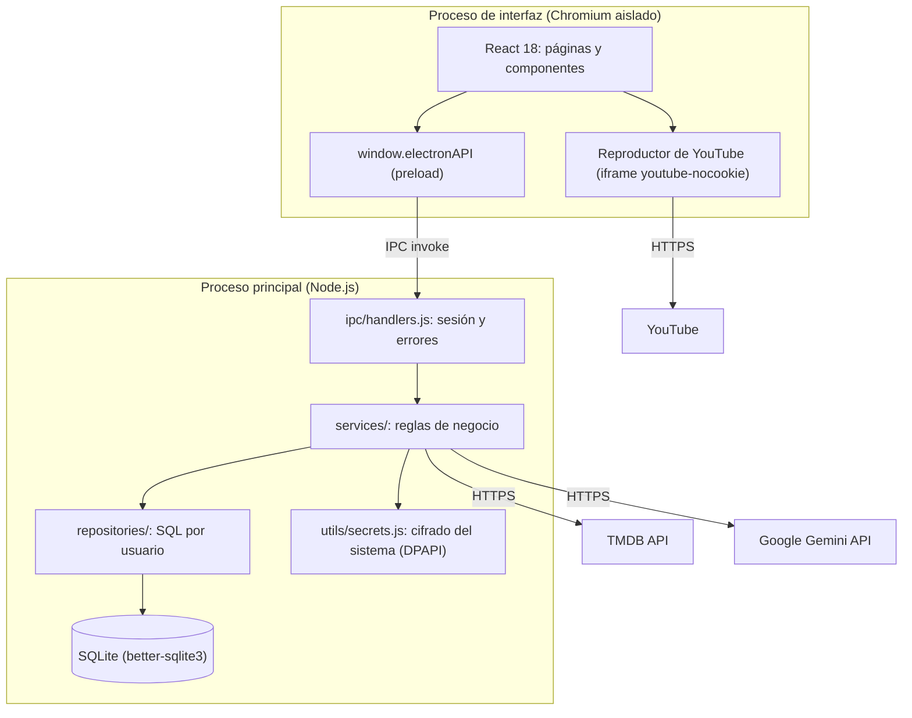
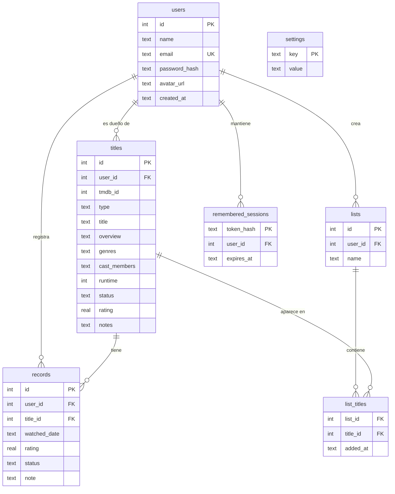

# CineTracker: informe técnico

**Proyecto final de Ingeniería de Software**
Universidad Cooperativa de Colombia (UCC), sede Pasto
Autor: Camilo Rosero
Versión de la aplicación: 1.0.0

---

## 1. Resumen

CineTracker es una aplicación de escritorio para registrar, calificar y descubrir películas y series. Funciona sin servidor propio: los datos de cada usuario se guardan en una base de datos SQLite en su computador. Se conecta a tres servicios externos:

- **TMDB:** metadatos, pósters y tendencias.
- **YouTube:** tráilers.
- **Google Gemini:** recomendaciones escritas por inteligencia artificial.

Si alguno de estos servicios falla, la aplicación sigue funcionando.

La interfaz está en español y sigue un sistema visual propio inspirado en las transmisiones deportivas: negro, verde cancha (#018751), titulares condensados, "lower-thirds" y marcadores de puntuación. Tiene tema claro y oscuro.

---

## 2. Requisitos cubiertos

| Requisito | Cómo se cumple |
|---|---|
| Uso como invitado y con cuenta | Los invitados ven tendencias y tráilers. Las acciones que modifican datos abren un inicio de sesión y, al terminar, continúan solas. |
| Varias cuentas por instalación | Cada título, registro y lista pertenece a un `user_id`; todas las consultas se filtran por usuario. |
| Catálogo con TMDB | Búsqueda con espera de 400 ms, navegación con teclado, vista previa con reparto; respaldo de entrada manual. |
| Ficha del título | Puntuación 1–10, estado, historial de visualizaciones, reparto, notas, listas, navegación entre títulos. |
| Tráilers | Selección automática del mejor tráiler de TMDB y reproducción con un componente reutilizable de YouTube. |
| Recomendaciones | Gemini con salida JSON validada; motor por reglas como respaldo, siempre con el motivo de cada recomendación. |
| Estadísticas | Totales con tendencia mensual, actividad de 12 meses, estados, géneros; cada gráfica con vista de tabla. |
| Listas, perfil y ajustes | Listas con nombre; foto y nombre; cambio de contraseña; tema; claves de API; eliminación de cuenta. |
| Sesión recordada | Opcional, 30 días, con token cifrado por el sistema operativo. |
| Accesibilidad | Etiquetas en todos los controles, foco visible, contraste AA en ambos temas, objetivos de 44 px, respeto de "reducir movimiento". |
| Entrega | Instalador NSIS en español y versión portátil para Windows; variante sin claves para compartir. |

---

## 3. Arquitectura

### 3.1 Vista general



La aplicación sigue una arquitectura por capas dentro de Electron:

- **Interfaz (renderer):**
  - Corre en Chromium con `contextIsolation`, `sandbox` y sin `nodeIntegration`.
  - No tiene acceso a Node, al disco ni a las claves de API. Todo pasa por los métodos de `frontend/electron/preload.js`.
- **Canal IPC:**
  - `backend/ipc/handlers.js` registra cada canal y resuelve el usuario de la sesión.
  - Los canales de lectura devuelven resultados vacíos a los invitados; los que modifican datos los rechazan.
  - Los errores de validación llegan al usuario con un mensaje en español. Los errores internos (SQL, programación) se registran y se muestran como un mensaje genérico.
- **Servicios:** validan la entrada y aplican las reglas de negocio (`auth`, `title`, `record`, `list`, `statistics`, `recommendation`, `aiRecommendation`, `tmdb`, `imageCache`, `apiKey`, `remember`).
- **Repositorios:** contienen solo SQL parametrizado y siempre filtran por `user_id`.
- **Base de datos:**
  - SQLite en la carpeta de datos del usuario.
  - Migraciones versionadas con `PRAGMA user_version`; cada una corre una sola vez, dentro de una transacción, después de copiar el archivo de la base de datos.

### 3.2 Estructura del código

```
backend/      db/ (esquema y migraciones) · ipc/ · repositories/ · services/ · utils/ · tests/
frontend/     electron/ (main.js, preload.js) · src/ (pages, components, context, hooks, utils, styles)
docs/         manual de usuario, informe técnico y capturas
```

### 3.3 Modelo de datos



Migraciones:

| Versión | Cambio |
|---|---|
| 0 | Esquema base (`schema.sql`). |
| 1 | Propiedad por usuario de títulos, registros y listas. Los datos que existían pasan a la cuenta más antigua. |
| 2 | Reparto (`cast_members`) en los títulos. |
| 3 | Sesiones recordadas (`remembered_sessions`). |

Los géneros se guardan con su nombre en inglés de TMDB, obtenido a partir del identificador del género. Así los datos son estables aunque los metadatos se pidan en español, y la interfaz los traduce al mostrarlos. Los géneros combinados de series (por ejemplo "Sci-Fi & Fantasy") se separan en sus equivalentes de película para que las estadísticas cuenten películas y series juntas.

---

## 4. Integraciones externas

### 4.1 TMDB

- Las llamadas salen del proceso principal, así la clave nunca llega a la interfaz.
- Los metadatos se piden en español latinoamericano (`es-MX`). Si un título no tiene sinopsis en español, se usa la de inglés.
- Los pósters y fondos se sirven por un protocolo propio, `ctimg://`, que los guarda en disco. Así el catálogo funciona sin internet después de ver cada imagen una vez.

### 4.2 Tráilers (YouTube)

- **Selección** (`tmdbService.getTrailer`): entre los videos de TMDB se descartan los que no son de YouTube y los identificadores mal formados. El resto se ordena así:
  1. Tráiler antes que avance (teaser).
  2. Español antes que inglés.
  3. Oficial antes que no oficial.
  4. Más reciente primero.

  El resultado se guarda en caché seis horas.
- **Componente reutilizable** (`YouTubePlayer.jsx`):
  - Inserta el reproductor del dominio de privacidad mejorada `youtube-nocookie.com` en un `iframe` 16:9 con `sandbox`, título accesible y estado de carga.
  - Valida que el identificador tenga el formato de YouTube antes de construir la URL.
  - `TrailerModal.jsx` lo usa desde el Inicio y desde la ficha del título.
- **Seguridad en Electron:**
  - La política de seguridad de contenido solo permite marcos de `youtube-nocookie.com`, y el proceso principal bloquea cualquier navegación de un marco hacia otro origen.
  - El único permiso concedido es la pantalla completa, y solo al reproductor.
  - Los enlaces a YouTube se abren en el navegador del sistema.
- **Error 153:** YouTube rechaza los videos insertados cuya petición no indica de dónde viene. Una aplicación empaquetada carga sus páginas desde `file://` y no envía esa cabecera. Como YouTube pide a las aplicaciones de escritorio y WebView, la petición del reproductor se identifica con la aplicación (`Referer: https://com.cinetracker.app/`).

### 4.3 Recomendaciones con IA (Google Gemini)

- **Modelo y petición:** `gemini-3.8-flash`, configurable con `GEMINI_MODEL`, mediante la API REST `generateContent`. Se usa razonamiento bajo y un esquema JSON estricto: `{ recommendations: [{ title_id, reason }] }`.
- **Prompt:**
  - Incluye los títulos calificados (los 40 mejores) y los pendientes (hasta 60).
  - Delimita esos datos con etiquetas y le pide al modelo que los trate como datos, no como instrucciones.
  - Pide los motivos en español.
- **Validación de la respuesta:** se conservan solo identificadores que existen entre los pendientes del usuario, sin repetir y con un motivo no vacío.
- **Respaldo** (`recommendationService`): el motor por reglas toma el lugar de la IA en estos casos, y la interfaz explica cuál ocurrió:
  - Falta la clave.
  - Hay menos de 3 títulos calificados.
  - No hay conexión.
  - La clave es rechazada o se excede el límite de uso.
  - El contenido es bloqueado o la respuesta no sirve.
- **Caché:** el resultado se guarda por usuario mientras el catálogo no cambie, para no repetir llamadas pagadas.
- **Claude:** el código también admite Anthropic Claude si solo existe esa clave.

---

## 5. Seguridad

- **Contraseñas:** se guardan con bcrypt; nunca en texto plano.
- **Proceso de interfaz aislado:**
  - Sin acceso a Node; no puede abrir ventanas nuevas ni navegar fuera de la aplicación.
  - Se niegan todos los permisos (cámara, ubicación…), salvo la pantalla completa del reproductor.
- **Política de seguridad de contenido:**
  - Los scripts solo vienen de la aplicación.
  - Las imágenes vienen de la aplicación, de `ctimg:` o de `image.tmdb.org`.
  - Los marcos solo pueden ser de `youtube-nocookie.com`.
- **Entrada validada:** toda entrada por IPC se valida en los servicios. El SQL es parametrizado y las columnas actualizables están en una lista blanca.
- **Claves de API escritas en la aplicación:**
  - Se cifran con `safeStorage` de Electron (DPAPI en Windows) y tienen prioridad sobre `backend/.env`.
  - La interfaz solo recibe de dónde viene cada clave, nunca su valor.
- **Sesión recordada:**
  - Se genera un token aleatorio de 32 bytes, cifrado con el sistema operativo.
  - La base de datos guarda solo su hash SHA-256, con vencimiento de 30 días que se renueva al usarse.
  - Una copia de la base de datos en otro equipo no sirve para entrar, porque el token no se puede descifrar allí.
  - Se borra al cerrar sesión, al eliminar la cuenta o si no se puede abrir.
- **Claves en el repositorio:** `backend/.env` está en `.gitignore` y el historial de git no contiene claves.
- **Instaladores:** el instalador normal incluye `backend/.env` para funcionar de inmediato, así que solo debe compartirse con personas de confianza. El instalador `-sin-claves` no incluye claves y es el adecuado para distribuir.

---

## 6. Pruebas

`npm test` ejecuta **136 pruebas automáticas** con Vitest, sobre el Node de Electron para que el módulo nativo de SQLite coincida.

**Backend (120 pruebas, `backend/tests/`), sobre bases de datos temporales:**

- **Migraciones:** bases nuevas, actualización de bases anteriores a las cuentas, copias de seguridad e idempotencia.
- **Autenticación y perfil:** registro, inicio de sesión, cambio de contraseña, fotos, eliminación de la cuenta en cascada.
- **Catálogo:** reglas de títulos, registros y listas; mensajes de validación; aislamiento entre usuarios.
- **Estadísticas:** totales, tasa de finalización, horas, actividad mensual, tendencias, géneros unificados.
- **Recomendaciones:** motor por reglas y cada caso de respaldo de Gemini y Claude, con clientes simulados (sin llamadas pagadas).
- **TMDB, tráilers y caché de imágenes:** normalización, español con respaldo en inglés, selección de tráiler, seguridad de rutas, uso sin internet.
- **IPC, claves y sesiones:** restricciones a invitados, ocultamiento de errores internos, cifrado de claves, precedencia de fuentes, sesión recordada (vencimiento, cierre de sesión, base de datos copiada).

**Interfaz (16 pruebas, `frontend/src/**/*.test.jsx`), con Testing Library en jsdom:**

- Reproductor de YouTube: dominio, sandbox, validación del identificador y estado de carga.
- Pantalla del tráiler: encontrado, inexistente, error y reintento, cierre.
- Formulario de acceso: validaciones en español, opción de recordar, errores del servidor.
- Utilidades de etiquetas, géneros, fechas y tendencias.

**Verificación manual y automatizada de la aplicación real:**

- Recorridos por todas las páginas mediante el protocolo de depuración de Chromium, sin errores en consola y sin textos en inglés.
- Reproducción efectiva de tráilers (el video avanza sin errores de YouTube).
- Carrusel del Inicio y sesión recordada tras reiniciar.
- Las mismas comprobaciones sobre la aplicación empaquetada.

---

## 7. Construcción y entrega

| Comando (en `frontend/`) | Resultado |
|---|---|
| `npm run dev` | Desarrollo con recarga en caliente. |
| `npm test` | Las 136 pruebas. |
| `npm run dist:win` | `CineTracker-Setup-1.0.0.exe` (instalador en español) y `CineTracker-Portable-1.0.0.exe`, con las claves de `backend/.env`. |
| `npm run dist:win:nokeys` | Los mismos ejecutables, terminados en `-sin-claves`, sin ninguna clave. |

Los archivos se generan en `C:\CineTracker-release`. El instalador no lleva firma digital comercial, por lo que Windows SmartScreen muestra un aviso la primera vez (ver el manual de usuario).

---

## 8. Decisiones de diseño

- **Electron con React en lugar de una aplicación web:** los datos se quedan en el equipo del usuario, sin servidor ni costos de alojamiento, y la aplicación funciona sin conexión.
- **SQLite con migraciones versionadas:** permitió añadir cuentas, reparto y sesiones sin perder los datos de versiones anteriores.
- **Reproductor de YouTube propio en lugar de `react-native-youtube-iframe`:** esa librería es para React Native y depende de `react-native-webview`, que no existe en Electron. El componente propio usa el mismo reproductor oficial que esa librería usa por dentro, sin dependencias.
- **Respaldo por reglas para la IA:** las recomendaciones nunca quedan vacías por un problema de red, de clave o del modelo, y el usuario siempre sabe por qué ve cada recomendación.
- **Sistema visual de transmisión deportiva:** una identidad propia, en lugar de una copia de las plataformas de streaming, con un solo color de marca y profundidad por superposición, sin brillos.

---

## 9. Limitaciones y trabajo futuro

- El instalador no está firmado; firmarlo requiere un certificado de pago.
- Solo se probó el empaquetado para Windows. La configuración para macOS y Linux existe, pero no se verificó.
- Las recomendaciones con IA dependen de la cuota de la clave de Gemini.
- Mejoras posibles:
  - Sincronización opcional entre equipos.
  - Importar el historial desde otros servicios.
  - Notificaciones de estrenos de los títulos pendientes.
